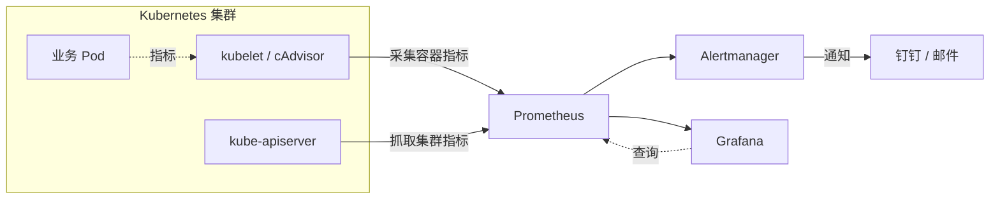

# k8s-Prometheus-starting

基于 Kubernetes 的容器监控与告警实践：从集群部署、指标采集到告警闭环，记录每一步的配置与踩坑过程。

> 一句话：用 kubeadm 搭一套可用的 K8s 环境，接上 Prometheus + Grafana + Alertmanager，让集群出问题时能在手机上收到通知。

## 架构



> 上图用 Mermaid 绘制，GitHub 会自动渲染。如果你的架构和这个不同，直接改这段代码即可。

## 技术栈

| 层次 | 组件 |
|---|---|
| 容器编排 | Kubernetes（kubeadm 部署） |
| 容器运行时 | containerd / Docker |
| 指标采集 | Prometheus、cAdvisor、node-exporter |
| 可视化 | Grafana |
| 告警 | Alertmanager → 钉钉 / 邮件 |
| 镜像仓库 | Harbor（可选） |

## 快速开始

> 目标：一个从零开始的读者，能照着这几步把环境跑起来。

### 1. 准备环境

- 3 台主机（推荐 2C4G 以上），CentOS 7 / Ubuntu 20.04
- 关闭 swap、关闭防火墙、配置时间同步
- 各节点 hostname 与 /etc/hosts 互相可达

### 2. 部署集群

```bash
# 初始化第一个 master
kubeadm init --control-plane-endpoint=<VIP>:6443 --upload-certs

# 配置 kubectl
mkdir -p $HOME/.kube
cp -i /etc/kubernetes/admin.conf $HOME/.kube/config

# 加入其他 master / worker（命令以 init 输出为准）
kubeadm join <VIP>:6443 --token <token> \
  --discovery-token-ca-cert-hash sha256:<hash> \
  --control-plane --certificate-key <key>
```

### 3. 部署监控

```bash
helm repo add prometheus-community https://prometheus-community.github.io/helm-charts
helm repo update
helm install kube-prom prometheus-community/kube-prometheus-stack -n monitoring --create-namespace
```

### 4. 访问 Grafana

```bash
kubectl -n monitoring port-forward svc/kube-prom-grafana 3000:80
# 浏览器打开 http://localhost:3000
```

## 目录结构

```
.
├── deploy/      # 集群与应用部署的 yaml / helm values
├── monitor/     # 告警规则、Grafana 面板 JSON
└── docs/        # 故障排查记录、操作手册
```

## 遇到的问题

> 这一节是本仓库最有价值的部分。每个问题按「现象 → 定位过程 → 根因 → 解决」写。

### 1. （待填）Pod 一直 Pending

- **现象**：
- **定位**：`kubectl describe pod <name>` 看到 Events 里是 …
- **根因**：
- **解决**：

### 2. （待填）Pod 镜像拉取失败

- **现象**：`ImagePullBackOff`
- **定位**：网络原因，镜像名称，节点状态
- **根因**：
- **解决**：

### 3. （待填）PVC 一直 Pending

- **现象**：
- **定位**：
- **根因**：
- **解决**：


## 说明

本仓库仅用于个人学习与技术验证，所有配置中的 IP、域名、密码均为占位符，请替换为你自己的环境。
